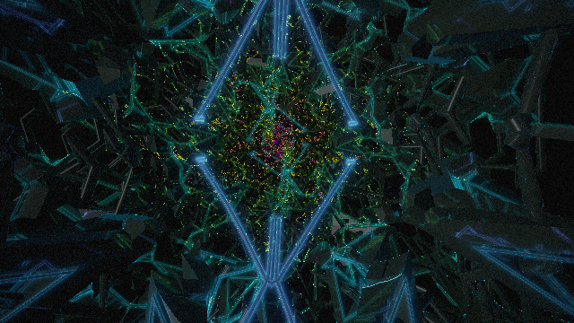

# 4k

A demoscene-style 4K intro: one self-contained HTML file, **3,826 bytes**, with no libraries and no assets.

Open `index.html` in a browser and click to start (audio needs a click because of autoplay rules). Headphones help.

## What's inside

- **Visuals:** a single WebGL fragment shader raymarches a folded (KIFS) fractal tunnel. It has dark metal girders with glowing neon tubes, one reflection bounce, energy pulses running down the tubes, kick-synced field-of-view pulses, film grain, and four scenes. Each scene ends in a hyperspace warp and a white-flash cut.
- **Audio:** a 64-second looping track synthesized sample by sample in JavaScript on click. It has a pitch-swept kick, hats, snare, a filtered saw bass, detuned pads, an arpeggio with ping-pong delay, an FM bell lead, sidechain ducking, and noise risers into each scene change.

## Source

`index.html` is generated, so edit the files in `src/`:

- `src/fs.glsl` is the readable fragment shader.
- `src/tpl.html` is the page and audio synth, with a `$FS` placeholder for the shader.
- `src/build.js` minifies the shader, inlines it and writes `index.html`. Run it with `node src/build.js`. It prints the byte count.
